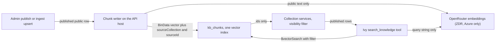

# ADR-0014: Search public content by meaning with Atlas Vector Search on the existing cluster

| Field | Value |
|---|---|
| **Status** | Proposed |
| **Date** | 2026-10-18 |
| **Deciders** | Wes Huber |
| **Related** | [ADR-0007](/architecture/adrs/adr-0007-no-third-party-analytics), [ADR-0008](/architecture/adrs/adr-0008-database), [ADR-0012](/architecture/adrs/adr-0012-companion) |

## Context

Wes asked whether Vegan Grove has a knowledge base, such as a Qdrant database, to gather what the app knows (Guides, the media library, the new [Creators](/features/creators) directory, places, events) into one place Ivy can draw on. It does not. Today Ivy reaches data only through read-only tool calls over the same services the REST routes use ([ADR-0012](/architecture/adrs/adr-0012-companion)), and those tools filter by fields and match text with indexes and regexes. That works for "fully vegan places in Long Beach". It does not work for "who explains B12 well", "a film about dairy that is not graphic", or "how do I answer 'plants feel pain'", where the words in the question are not the words in the row.

The corpus is small and public: about 1,100 places, a few dozen media titles, the Guides, and about thirty creators. All of it lives in one MongoDB Atlas Free cluster ([ADR-0008](/architecture/adrs/adr-0008-database)). MongoDB's documentation, checked on 2026-10-18, sets the limits that matter here:

- Free clusters store at most **0.5 GB** (512 MB), counting documents and their indexes ([Atlas Free cluster limits](https://www.mongodb.com/docs/atlas/reference/free-shared-limitations/)).
- Free clusters can have at most **3 search indexes in total, vector and full-text combined**; Flex clusters allow 10 and M10 and above have no fixed count ([Vector Search limitations](https://www.mongodb.com/docs/vector-search/deployment/compatibility-limitations/)).
- Vectors may have up to 8192 dimensions, and pre-quantized `BinData` vectors are supported from MongoDB 7.0.2; Free clusters run MongoDB 8.0 (same two pages).
- Free clusters are capped at 100 operations per second, 10 GB in and 10 GB out per rolling seven days, a 32 MB in-memory sort, and 500 connections, and pause after 30 days with no connections (Free cluster limits).

The same page now says Free clusters can enable a daily snapshot that keeps four copies. ADR-0008 says M0 has no backups; that line predates the change and is worth its own look.

## Decision

- **Tool calling stays the default.** Every Ivy answer about places, events, Guides, media, and creators keeps going through the existing read-only tools. Semantic search is an extra tool, `search_knowledge`, added only when a measured question type fails with the field tools. Until then, nothing is embedded.
- **When it is added, it is Atlas Vector Search on the existing cluster.** No second database, no new host, no new vendor for storage.
- **One collection, one index.** Chunks from every source live in `kb_chunks` with `sourceCollection`, `sourceId`, `chunkIndex`, `text`, `embedding`, `model`, `contentHash`, and `updatedAt`, under a single vector index with `sourceCollection` and `language` as filter fields. One index instead of one per collection is forced by the three-index ceiling, which full-text site search would also draw from.
- **What is embedded: published, public, non-member rows only.**

| Source | Text that is embedded |
|---|---|
| `guides` | title, summary, and the body split by heading |
| `media_items` | title, tagline, the admin-written synopsis, topics, content warnings |
| `creators` | name, the admin-written bio, topics, languages |
| `places` | name, type, vegan level, city, tags |
| `events` | public, published events only: title, type, city, description |

- **What is never embedded:** anything a member wrote or did. That is `users`, posts, comments, reviews and check-ins, messages, RSVPs, the action log, place lists, the watchlist, reactions, and Ivy conversations. Organizer names are already dropped at ingest. A draft, unpublished, retired, or `pending` row is never embedded, and unpublishing a row deletes its chunks in the same write path.
- **Results are ids, not answers.** `$vectorSearch` returns `sourceCollection` and `sourceId`; the service then loads each row through the normal service for that collection, which applies the visibility filter again. A stale chunk can never surface a row the public API would not return.
- **Storage is budgeted.** Vectors are stored as `BinData` float32, about 4 bytes per dimension instead of the 8 or more of an array of doubles. At about 3,000 chunks of 1,024 dimensions that is roughly 12 MB of vectors plus the index, a few percent of the 512 MB. The chunk writer refuses to run when the cluster's logical size passes 60 percent of the limit and logs why.
- **The writer runs on the API host**, after ingest and after an admin publishes, and re-embeds a row only when its `contentHash` changes. Bots never embed and never hold the embedding credential.
- **Embeddings come from OpenRouter** (decided by Wes on 2026-10-18). The model is `openai/text-embedding-3-small`, requested at **1,024 dimensions** through the `dimensions` parameter (its native size is 1,536), listed at $0.02 per million input tokens on 2026-10-18. Indexing the whole corpus once costs well under a cent. The API calls `POST https://openrouter.ai/api/v1/embeddings` with `OPENROUTER_API_KEY`. The model and dimension are configuration (`EMBEDDING_MODEL`, `EMBEDDING_DIMENSIONS`) and are recorded on every chunk; changing either means re-embedding everything, which at this size takes minutes.
- **What OpenRouter receives.** At index time: the public text in the table above. At query time: the search string Ivy's `search_knowledge` tool sends, which is written from what the member asked. Not the conversation, the handle, or the interests. OpenRouter forwards both to whichever upstream provider serves the model; with the routing below that is Microsoft Azure. Query strings are never logged by the API.
- **Routing is pinned to zero data retention.** Every request sends `provider: { "zdr": true, "data_collection": "deny", "only": ["azure"], "allow_fallbacks": false }`, and the OpenRouter account also has ZDR enforcement on for the OpenAI model group in its privacy settings. OpenRouter documents that `zdr: true` routes only to endpoints with a zero data retention policy, that `data_collection: "deny"` excludes providers that store or train on data, and that OpenRouter itself does not retain prompts unless prompt logging is opted in ([provider routing](https://openrouter.ai/docs/guides/routing/provider-selection), [zero data retention](https://openrouter.ai/docs/guides/features/zdr), checked 2026-10-18). On that date the only ZDR endpoint for this model was Azure, which is why `only` names it. Fallbacks are off, so if no zero-retention endpoint is available the request fails and Ivy falls back to the field tools instead of sending text somewhere else. Leave prompt logging off on the account.
- **This is not a reversal of [ADR-0012](/architecture/adrs/adr-0012-companion).** That ADR rejected OpenRouter for the companion because conversation text would fan out to many providers with different retention policies. Pinning one zero-retention endpoint with fallbacks off removes the fan-out for embeddings. Ivy's conversations still go to Anthropic directly.

## Alternatives considered

- **None: tool calling only.** Simplest, no new moving part, no new third party, and it is what ships first. Not enough on its own once Ivy is asked open questions about Guides and media, which is the reason to write this down now.
- **Self-hosted Qdrant on the API host.** Excellent filtering and a real vector engine, but the host is a t4g.micro ([ADR-0002](/architecture/adrs/adr-0002-backend-hosting)) with no memory to spare for a second database, and it adds a process to run, a store to back up, and a second place that every unpublish and retire must reach. Rejected for now.
- **Qdrant Cloud.** Its free tier is a single node with 1 GB RAM, 0.5 vCPU, and 4 GB disk, suspended after a week unused and deleted after four weeks of inactivity ([Qdrant cluster docs](https://qdrant.tech/documentation/cloud/create-cluster/), checked 2026-10-18). Capacity is not the problem; it is a new third party and a second store to keep in sync with the moderation state. Rejected for now.
- **pgvector on a Postgres instance.** A second database engine for one feature. Rejected, for the reasons in ADR-0008.

## When to move

Move in this order, and only when one of these is true and measured: first to an Atlas Flex or M10 tier, which lifts the index count and storage with no code change; then to Qdrant if the corpus passes about 100,000 chunks, if vector queries measurably slow the API's other reads, or if a feature needs something Atlas Vector Search does not do. The move is a new ADR. `kb_chunks` is derived data that can be rebuilt from the source collections, so the move needs no migration of anything a person wrote.

## Open questions

- **The embedding provider: resolved 2026-10-18.** OpenRouter, with the model, dimensions, and routing above. It is listed in the [data inventory](/privacy/data-inventory) under what third parties receive.
- **Site search.** Should the web search box use the same index (hybrid full-text and vector), or stay on indexed text search? Either way it shares the three-index budget.
- **Languages.** Guides are English; some creators publish in Italian or German. A multilingual model, or English only in v1?

## Consequences

### Positive

- No new database, vendor, or host. One backup, one allowlist, one place to delete from.
- The privacy boundary is structural: the chunk writer only reads published public rows, and results are re-read through the services that enforce visibility.
- Ivy can answer questions by meaning and still cite the Guide, film, or creator it found.

### Negative

- The three-index ceiling on Free clusters is shared with any future full-text search index. Mitigation: one `kb_chunks` index with filter fields.
- Vectors take space in a 512 MB cluster that also holds every member record. Mitigation: `BinData` vectors, the 60 percent guard, and the upgrade path above.
- Query embedding adds OpenRouter, and through it Azure, as parties that see the text of a member's search. Mitigation: only the tool's query string is sent, routing is pinned to a zero-retention endpoint with fallbacks off, the API never logs the query, and the inventory row exists before the tool ships.
- Routing depends on OpenRouter's published data policies, which can change. Mitigation: the ZDR endpoint list is published at `https://openrouter.ai/api/v1/endpoints/zdr`; recheck it whenever the model or routing changes, and at least quarterly.
