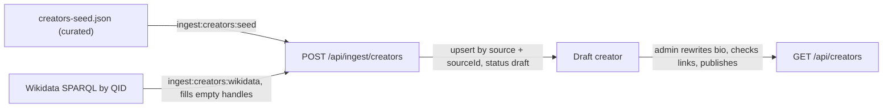

# Creators

Status: **Proposed 2026-10-18**

A new vegan asks the same question in every group chat: who should I watch to learn to cook, to answer my uncle, to train, to do outreach? Creators is the answer as a directory. Each entry is a public figure who makes vegan content in public: a name, two lines in our own words about what they make, topics, region and language, and links out to their own site and channels. It sits in the Learn step next to [Guides](/features/guides) and [Media](/features/media), and it follows the media library's pattern: a curated seed, enrichment from an open source, every row landing `draft` until an admin publishes it, and everything a member clicks leaving the app.

## Why

- **Learn.** A trusted short list beats an algorithm's feed. A member who wants to start cooking gets eight cooks, not eight hundred.
- **Act.** Many creators are also organizers, authors of Guides-worthy material, or people on screen in the media library. Linking them closes the loop from "I watched it" to "here is who to learn outreach from next".
- **Ivy.** The companion can answer "who explains B12 well" from a published list instead of from whatever the model remembers.

## What ships in v1

- A browse page with topic pills (outreach, animal rights, cooking, nutrition, fitness, environment), a language filter, and search by name.
- A creator page: name, the bio, topics, country and languages, the links, and related Guides and Media.
- About thirty seeded entries, reviewed and published by an admin. The first draft list was researched on 2026-10-18 and is kept off the repos until this spec is accepted.
- An admin API to edit, publish, unpublish, and retire an entry.

## What it is deliberately not

- **Not a ranking.** No follower, subscriber, view, or like counts are fetched, stored, or shown, and nothing is ordered by reach. The default order is alphabetical; editor shelves ("Start here for cooking") are the only curation. No "top" anywhere in the product copy. This is the `SOUL.md` rule on clout, applied to people outside the app as well as inside it.
- **Not a feed of their posts.** No embedded posts, no pulled thumbnails, no "latest video" row. Their content stays on their platforms.
- **Not scraped.** Facebook and Instagram are never data sources, and no social platform is read at all. A handle is stored so a link can be built; that is the whole relationship.
- **Not a member feature.** Creators do not get accounts, cannot claim a page, and cannot message members. Members cannot follow a creator in the app. Businesses and brands are not creators.
- **Not an endorsement.** Inclusion means "publicly vegan and makes useful content about one of the topics", not agreement with everything a person says. Sponsored placement is ruled out, as everywhere else.
- **No photos in v1.** A portrait from a social platform is not ours to rehost and hotlinking is ruled out. Pages show initials on the shared tokens. A rights-cleared portrait, uploaded to our bucket like a poster, is an open question.

## Who is included

An entry needs all of these, checked by a person before the seed row is written:

1. Publicly vegan, with a citable source (Wikidata `lifestyle` P1576 = veganism, a Wikipedia article, or the creator's own site saying so) recorded in `veganSource`.
2. Active: published something public in the last twelve months.
3. Makes content about at least one topic in the vocabulary.
4. A person or a small named team (BOSH! is two people), not a company, an org (those are [organizations](/ingest/organizations)), or a celebrity whose veganism is incidental to their work.
5. No public record of harassment, hate, or medical claims that contradict the cited nutrition Guides. This is an editorial call, made by an admin and written down in the review note.

Someone who publicly stops being vegan is unpublished at the next review. The page is not edited to say so; it just stops being listed.

## Data and visibility

`creators` is a public collection with no member data. It describes public figures acting publicly, using only what they publish themselves, so it adds no row to the personal-data tables of the [data inventory](/privacy/data-inventory); it is listed there under ingested public data.

| Field | Type | Rule |
|---|---|---|
| `name` | string | as the creator writes it |
| `slug` | string | generated on insert, never changes |
| `alsoKnownAs` | string[] | channel or brand names ("Pick Up Limes") |
| `kind` | `person`, `duo`, `team` | |
| `members` | string[] | names, only for `duo` and `team` |
| `bio` | string, at most 280 characters | written in our own words by an admin; never copied from the creator or from Wikipedia |
| `topics` | string[] | vocabulary `outreach`, `animal-rights`, `cooking`, `nutrition`, `fitness`, `environment`, plus free tags such as `philosophy` or `food-justice` |
| `country` | ISO 3166-1 alpha-2 | where they are based, not citizenship |
| `languages` | ISO 639-1[] | the languages they publish in |
| `website` | https URL | their own site |
| `podcast` | https URL | the show's own page |
| `socials` | `{ youtube, instagram, tiktok, x, bluesky, mastodon }` | handles only, the same rule as [organizations](/ingest/organizations); `youtube` is a channel id (`UC...`) or a path under the site such as `@name`. The clients build the links. |
| `externalIds` | `{ wikidata }` | |
| `veganSource` | `{ url, label }` | the citation for inclusion rule 1; shown on the page as "Source" |
| `relatedGuideIds`, `relatedMediaIds` | ObjectId[] | set by admins |
| `status` | `draft`, `published`, `retired` | |
| `reviewedAt` | date | last time an admin checked the links and the inclusion rules |
| provenance | `source`, `sourceId`, `sourceUrl`, `lastSeenAt`, `adminEdited` | as on every [ingested collection](/architecture/data-model) |

Indexes: unique `slug`; unique partial `source + sourceId`; `status + name` for the alphabetical browse; `status + topics`; `status + languages`; unique sparse `externalIds.wikidata`. There is deliberately no field that could hold a count.

## Ingest

Creators follow the [ingest contract](/ingest) with a new resource, `POST /api/ingest/creators`, under the same `X-Ingest-Key`, 200-item envelope, zod validation, `200`/`207` responses, and rate limit. Upserts never delete. A creator who should leave the directory is retired by an admin, not by a missing row.

### The curated seed

`scripts/data/creators-seed.json` in the API repo is the list and the editorial layer, like `media-seed.json`. `ingest:creators:seed` sends it with `source: curated` and a kebab-case `sourceId` (`ed-winters`). Keys that start with `_` hold the researcher's notes (where each link came from, when it was checked) and are dropped by the mapper.

```json
{
  "sourceId": "ed-winters",
  "name": "Ed Winters",
  "alsoKnownAs": ["Earthling Ed"],
  "kind": "person",
  "wikidata": "Q65930940",
  "bio": "Educator and author who makes the ethical case for veganism through talks, books, and street conversations.",
  "topics": ["outreach", "animal-rights"],
  "country": "GB",
  "languages": ["en"],
  "website": "https://earthlinged.org/",
  "socials": { "youtube": "UCVRrGAcUc7cblUzOhI1KfFg", "instagram": "earthlinged" },
  "veganSource": { "url": "https://en.wikipedia.org/wiki/Ed_Winters", "label": "Wikipedia" },
  "sourceUrl": "https://www.wikidata.org/wiki/Q65930940"
}
```

### Wikidata enrichment

Wikidata is CC0 and is the only automated source. `ingest:creators:wikidata` reads the QIDs in the seed and fills in handles the seed left empty. It re-sends each row under its existing key (`source: curated`, the same `sourceId`), so the upsert updates the row instead of creating a second one.

```sparql
SELECT ?person ?website ?youtube ?instagram ?tiktok ?x ?bluesky ?vegan WHERE {
  VALUES ?person { wd:Q65930940 wd:Q6830782 }
  OPTIONAL { ?person wdt:P856 ?website }
  OPTIONAL { ?person wdt:P2397 ?youtube }
  OPTIONAL { ?person wdt:P2003 ?instagram }
  OPTIONAL { ?person wdt:P7085 ?tiktok }
  OPTIONAL { ?person wdt:P2002 ?x }
  OPTIONAL { ?person wdt:P12361 ?bluesky }
  BIND(EXISTS { ?person wdt:P1576 wd:Q181138 } AS ?vegan)
}
```

| Creator field | Wikidata property | Rule |
|---|---|---|
| `website` | P856 official website | only when the seed has none |
| `socials.youtube` | P2397 YouTube channel ID | only when the seed has none |
| `socials.instagram` | P2003 Instagram username | handle for a link; Instagram itself is never read |
| `socials.tiktok` | P7085 TikTok username | handle for a link |
| `socials.x` | P2002 X username | handle for a link |
| `socials.bluesky` | P12361 Bluesky handle | handle for a link |
| `veganSource` | P1576 lifestyle = veganism (Q181138) | used only when the seed has no source |

A curated value always wins over Wikidata, an admin edit always wins over both, and a deprecated-rank statement is skipped. Send the query with `Accept: application/sparql-results+json` and the project `User-Agent`.

Wikidata can also suggest candidates (people with P1576 = veganism and a YouTube channel id; about a hundred on 2026-10-18), but a suggestion only becomes a seed row after a person applies the inclusion rules. Discovery never writes to the endpoint directly.

### Moderation

Every creator lands `draft`, whatever `TRUSTED_SOURCES` says, because every bio needs a person to write it. An admin reads the entry, rewrites the bio in the app's own words, opens each link, checks the inclusion rules, sets `reviewedAt`, and publishes. `published` never moves back through ingest.

### Future sources

The YouTube Data API is a sanctioned option for confirming that a channel id still exists and for refreshing a channel's display name. It is not used in v1, and if it is added it stores no statistics: the API's subscriber and view counts are dropped at the source like organizer names are in events. Every other platform stays link-only.



## API

Public: `GET /api/creators?topic=&lang=&q=&cursor=` (published only, alphabetical, cursor pagination) and `GET /api/creators/:slug`. Admin: `/api/admin/creators` for edit, publish, unpublish, retire, and related Guides and Media. Ingest: `POST /api/ingest/creators`. Public reads carry `Cache-Control: public, max-age=300, stale-while-revalidate=3600`; nothing here varies by viewer.

## Screens

Web: `/creators` and `/creators/[slug]`, server-rendered for SEO, listed in the sitemap and `llms.txt`. Mobile: a stack under `/creators` reached from Home's Learn step, next to Media; not a tab. Every outbound link opens the creator's own site or channel in the system browser with `rel="noopener noreferrer"` and no tracking parameters. Context, Action, Support: who this is and what they make, the links, then the related Guides and Media.

## Ivy

Ivy gets one more read-only tool, `find_creators({ topic?, language?, query? })`, which calls the same service as `GET /api/creators` and returns published entries only: name, bio, topics, languages, and the links. Ivy may recommend a creator and must say the list is curated, not ranked. Nothing about the member is passed to the tool beyond the query, and nothing is logged about which creators a member asked about. See [Ivy](/features/companion) and the [knowledge base ADR](/architecture/adrs/adr-0014-knowledge-base) for how creator bios may later be searchable by meaning. If that ships, the published bio and topics are sent to OpenRouter for embedding, as that ADR describes.

## Takedown and opt-out

Every creator page has an "Is this you?" link to a short public form with two fields: the request, and a link to the creator's own channel or site so we can confirm it and reply there. There is no name or email field. It creates a row in `reports` like any other moderation item, with the same retention. Which public contact address backs the form is an open question.

- **Removal:** an admin sets `status: retired` within seven days, and the slug answers `410 Gone`. The row is kept with the reason so a re-ingest never brings it back; `retired` is a moderation state and never moves backwards.
- **Correction:** a wrong link or bio is fixed and the field is added to `adminEdited`.
- **Seed:** the same pull request removes the entry from `creators-seed.json` so the request is honored in the source, not only in the database.

No proof of identity is needed to be removed; a request from the creator's own published contact or channel is enough. Removal is always granted.

## Signal

Outbound link taps per published creator, counted in aggregate per day with no member id, per [ADR-0007](/architecture/adrs/adr-0007-no-third-party-analytics). The count is for admins deciding what to review and is never shown publicly or used for ordering.

## Rollback

The routes and screens sit behind one flag. Turning it off hides the directory and Ivy's tool; the collection is public data and can stay or be dropped without touching any member record.

## Open questions

- **The name: decided 2026-10-18.** The section is "Creators" (Wes). It avoids the word "influencer", which reads as clout.
- **Who reviews inclusion.** Proposal: Wes publishes the first thirty; after that any admin, with a second admin for anyone flagged as contentious.
- **Portraits.** Initials only, or ask each creator for a rights-cleared portrait to host ourselves?
- **SoCal first or global?** The first list is international and English-first. Should local creators (organizers, chefs, sanctuary voices in Southern California) get their own shelf or wait for Groves?
- **Celebrities.** Actors and athletes who are vegan but do not make vegan content are excluded by rule 4. Keep that line?
- **Suggest a creator.** A member form that creates a draft, like "suggest a film". Next milestone or never?
- **Takedown contact.** The form needs a public reply address that is not a maintainer's personal email, per the [disclosure policy](/privacy/disclosure-policy). A role address on the product domain?
- **YouTube Data API.** Worth a key to confirm channels still exist, given the no-statistics rule?
