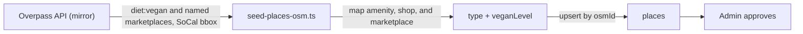

# Place data sources

Status: **Proposed 2026-09-24**, first import run 2026-09-29; farmers markets and Open Library noted 2026-10-24. Ingest rules are on the [ingest places](/ingest/places) page and the [ingest media](/ingest/media) page.

Places come from three sources, in order of trust: curated, member-submitted, imported. All three land as `pending` and are approved by an admin before they appear, unless the source is listed in `TRUSTED_SOURCES` ([ingest contract](/ingest)). Every imported row carries `source` and `sourceId`; on OSM rows `sourceId` is the `osmId`. Books, covered at the end of this page, go into the media library.

## Curated

Sanctuaries and organizations are curated by hand from their own websites, because they are few, they matter most, and their details (visiting rules, volunteer programs) do not live in any open dataset. `source: 'curated'`.

## Member-submitted

Any signed-in member can submit a place with a pin, a type, a vegan level, and a photo. `source: 'user'`, `submittedBy` stored for moderation and never displayed.

## OpenStreetMap

OpenStreetMap tags places with `diet:vegan=yes` (vegan options) and `diet:vegan=only` (fully vegan). A bounding box over Southern California (roughly Ventura to the Mexican border, the coast to the Inland Empire) contained 546 usable places on 2026-09-29, the day of the first import. This is the seed for restaurants, cafes, groceries, and shops.

The importer is `scripts/seed-places-osm.ts` in the API repo:

Rules:

- One tiled query covers both clauses: `nwr["diet:vegan"~"^(yes|only)$"]` and named `nwr["amenity"="marketplace"]`, `out center tags`.
- `amenity=restaurant` to `restaurant`, `amenity=fast_food` only when `diet:vegan=only` (otherwise skipped), `amenity=food_court` to `restaurant`, `amenity=cafe|ice_cream` to `cafe`, `amenity=bar|pub` to `venue`, `shop=supermarket|greengrocer|health_food|convenience` to `grocery`, other `shop=*` to `shop`. Unknown tags are skipped and counted.
- `diet:vegan=only` to `veganLevel: 'full'`, `yes` to `'options'`.
- Upsert by `osmId` so re-runs update rather than duplicate. Existing approved places keep their approval; changed coordinates or names are flagged for review, not overwritten.
- The importer sends a descriptive `User-Agent` and runs against the Kumi Systems mirror, because the main Overpass instance refuses generic clients.
- `--dry-run` prints counts only. `--approve` exists for the first import of a curated source: new rows land approved and existing pending OSM rows are promoted, because a map with zero places helps nobody and the verification flow handles corrections from there. The importer never runs in CI and never against production without a human in the loop.
- The first production import (2026-09-29) ran with `--approve`: 546 OSM places plus 3 hand-checked sanctuaries from `scripts/data/sanctuaries.json`.

The importer is moving to `scripts/ingest/` and will POST to `POST /api/ingest/places` instead of writing to the database, with these additions from the [ingest contract](/ingest/places):

- The default map and list lean fully vegan: `full` sorts first and "include vegan options" is an opt-in toggle.
- `amenity=fast_food` is imported only when `diet:vegan=only`.
- A `brand` or `brand:wikidata` tag sets `chain: true`. Chains are hidden by default and never deleted.
- Richer fields: `phone`, `postcode`, `opening_hours`, and `cuisine`, `wheelchair`, `outdoor_seating`, `takeaway`, `delivery` as `key:value` tags, plus a generated one-sentence description when OSM has none.
- `area` is derived from coordinates, never from the free-text city.

### Farmers and produce markets

The same OpenStreetMap source, the same ODbL terms, and the same `ingest:places:osm` run. A named marketplace is imported when `marketplace` (or `marketplace:type`) is a farmers or produce value, or when the name reads as a farmers market, produce market, greenmarket, or farm stand. Flea, craft, and antique markets are left out.

They land as `type: grocery` with the tag `market:farmers`. Vegan level is `options` unless `diet:vegan=only`, which is `full`. `chain` stays false on these rows. Grocery is the existing buy-food type, so a current client can show a market, and the tag keeps a weekly market distinct from a store.

Attribution is unchanged. `source` is `osm`, `sourceId` is the OSM object id, and `sourceUrl` links to that object. Every Place with `source: 'osm'` shows "Data from OpenStreetMap contributors" on its page.

### Community gardens

A second query, `leisure=garden` with `garden:type=community` plus named `landuse=allotments`, imports gardens as `type: garden`, `veganLevel: full`. Unnamed allotments are skipped.

Attribution: OpenStreetMap data is ODbL. Every Place with `source: 'osm'` shows "Data from OpenStreetMap contributors" on its page, and the map itself carries the OSM attribution through the tile style.

## Open Library

Open Library feeds the media library. `ingest:media:openlibrary` searches the Open Library Search API for `subject:veganism` and `subject:"animal rights"` and upserts `kind: book` rows: title, authors, year, one ISBN, and a link to the work. Catalogue metadata is CC0. `source` is `openlibrary`. That source is outside `TRUSTED_SOURCES`, so books land `draft` until an admin publishes them.

Covers are downloaded, stripped of EXIF, XMP, and IPTC, and stored in the media bucket. The API receives the object key. Covers are re-hosted rather than hotlinked. The schedule, the one-second pause between calls, and `--dry-run` are on the [automations page](/ingest/automations). The field list is on the [data inventory](/privacy/data-inventory).

## What is not a source

- HappyCow, Yelp, Google Places. Their terms forbid bulk use, and Google Places would put a Google key back into the product ([ADR-0006](/architecture/adrs/adr-0006-maps)).
- Facebook and Instagram. They are never data sources. Social media scraping is not a source.
- The Trick Book's Chrome extension pattern (scraping Google Maps from a browser). Deprecated there, not carried here.

## Refresh

Quarterly: a run of the importer with `--dry-run`, review of the counts, then a real run. New OSM places enter as `pending`. The schedule and the stop conditions for an automated run are in the [bot runbook](/ingest/bot-runbook).
