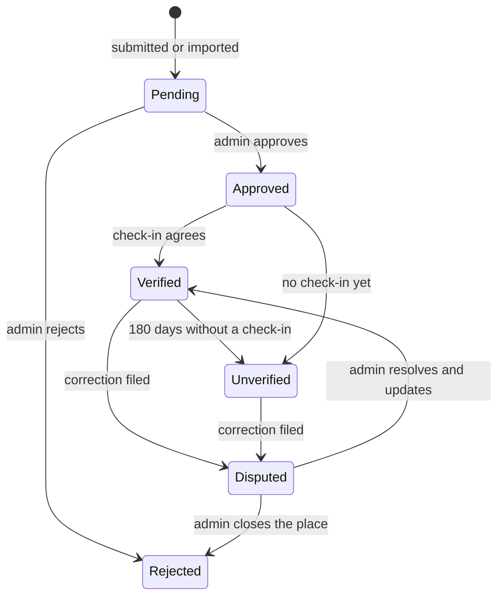

# Place verification

Status: **Proposed 2026-09-24**, check-ins implemented 2026-10-24. Disputed is not implemented yet.

A map of vegan places is only as good as its worst entry. A restaurant that dropped its vegan menu six months ago and still shows `full` costs a member a wasted trip and costs the app trust. The Trick Book has an admin-only `verified` flag on spot trick history; Vegan Grove needs verification that scales with members and stays anonymous.

## Signals

| Signal | Source | Weight |
|---|---|---|
| Approval | Admin reviewed the submission | Required to appear at all |
| Check-in | A member visited and confirmed the vegan level (rating optional) | Strong, decays over time |
| Correction | A member reports "vegan level is wrong" or "closed" | Strong negative, triggers review |
| Claim | The business claimed the Place and set details | Medium, shown as "claimed" |
| Source freshness | OSM last-modified date, curated review date | Weak |

A Place is specified with three verification states: **Verified** (a check-in in the last 180 days that agrees with the level), **Unverified** (no recent agreeing check-in), **Disputed** (an open correction). The API implements the first two. `verification` is `verified` or `unverified`. Disputed is not implemented yet: a place report has no correction subtype, so an open report is not treated as a dispute, and the place stays on the map with whichever of the two states the check-ins support. There is no member badge, no first-visitor flag, and no leaderboard.

## Anonymity

- Check-ins live in `place_checkins`, one row per member per place per UTC month. The server assigns the month. The client does not send it. `userId` is stored for that limit and so account deletion can detach the row. The Place page shows `checkInCount` and `latestCheckInMonth`, never who.
- The optional rating on a check-in is stored and returned by no route. A review is a separate row in `place_reviews`. A past visit month belongs on the review as `visitedMonth`. The handle shows only when that review set `showHandle` and the account still exists.
- Corrections are reports (`reports` collection, target type `place`) and are handled by admins. The reporter is never shown. Filing one does not flip the place to Disputed.
- Admin tooling shows the handle of a reporter only when needed to handle abuse, and never lists them.

## Flow

The Verified and Unverified transitions are what the API does today, from `places.lastAgreeingCheckInAt` and a 180-day window. The Disputed transitions are the design above. They are not implemented yet.

## Open questions

- Should a fully vegan place that receives a "now has non-vegan items" correction flip to `options` automatically after two independent corrections, or always wait for an admin? Proposal: wait for an admin in v1, automate when there is data on false-correction rates.
- Whether businesses that claim a Place can see check-in counts. Proposal: yes, counts only.
